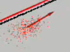
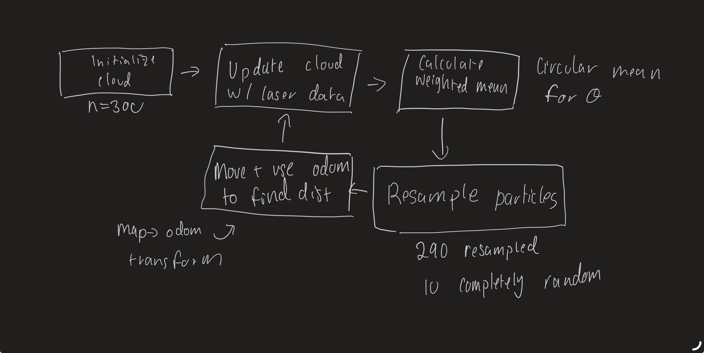
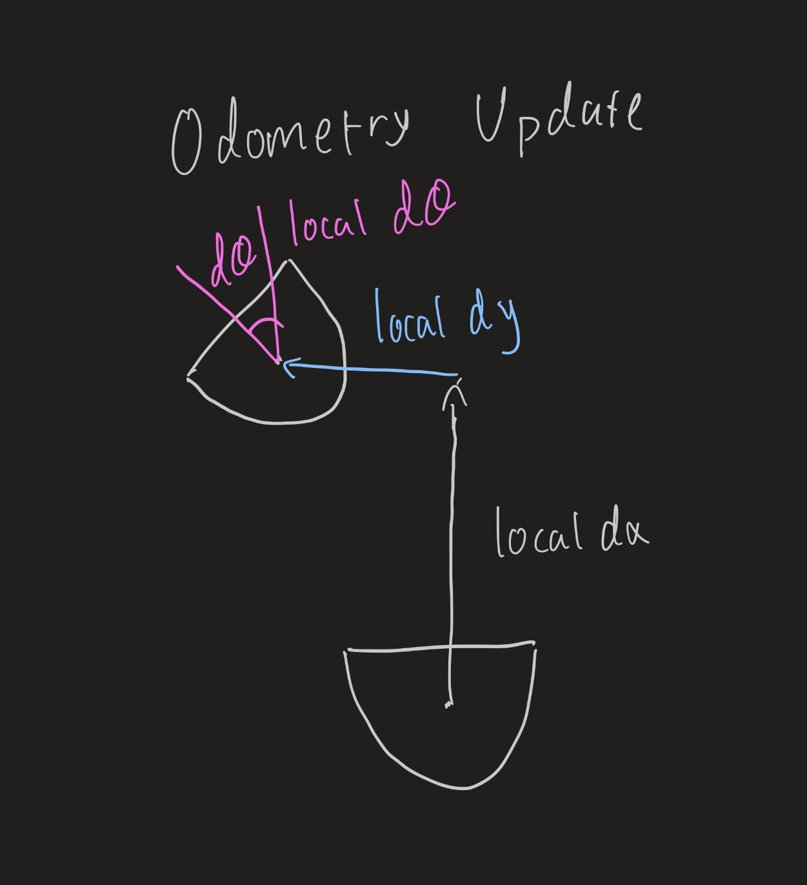
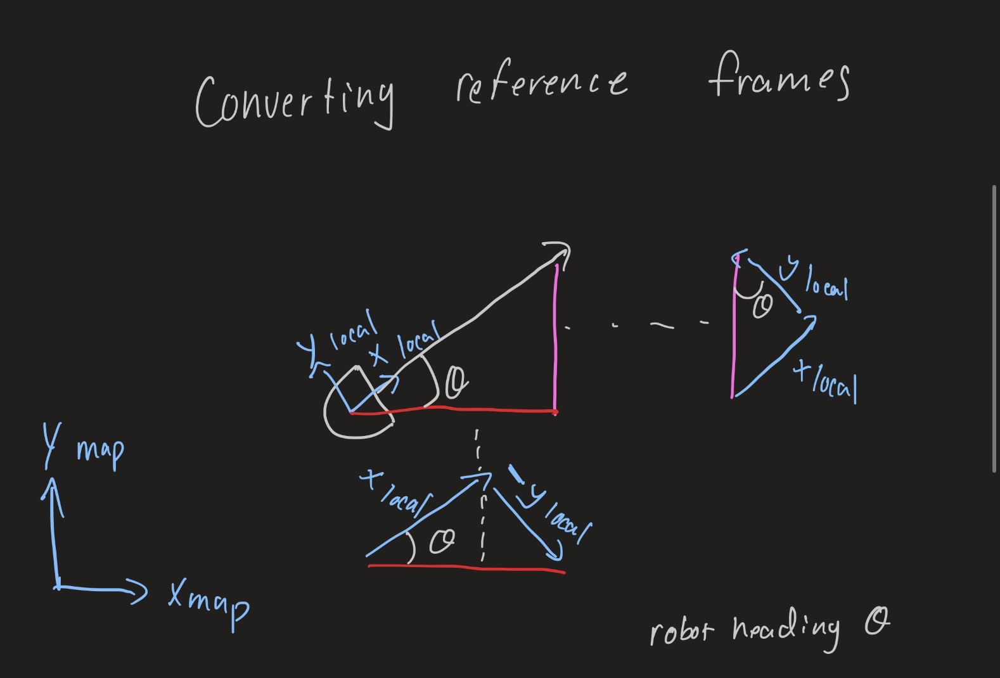
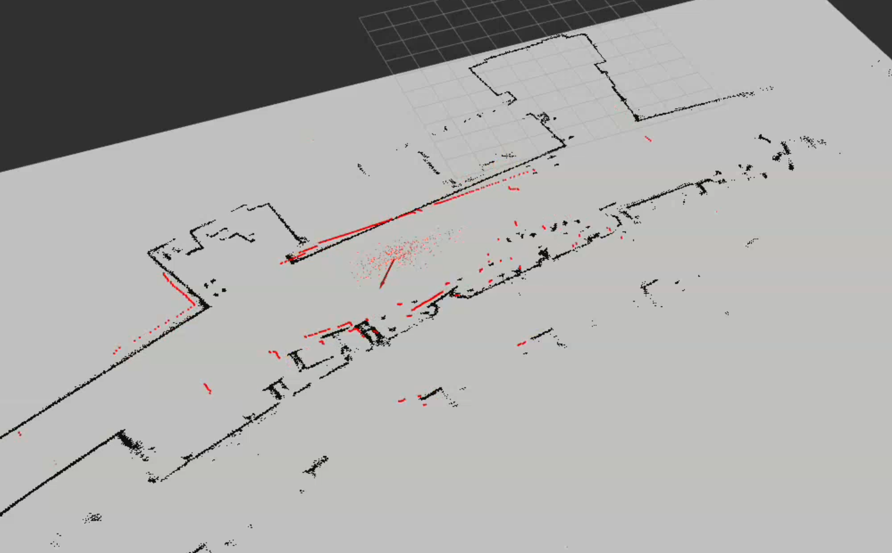

# Robot Localization through Particle Filter
Akil Pugalenthi & Siddhant Kulkarni

## Project Goal
The goal of a particle filter is to answer the grounding question "Where am I?" In the context of a robot. A particle filter can be used when the robot has near-perfect information of its environment, but does not know where in the environment it is. Our goal was to implement several key functions in the particle filter, which is in pf.py. This includes key logic on how particles are initialized, how particles are selectively resampled, how particle's weights are updated based on odometry data, and more.

*Figure 1*
## Approach

Our particle filter method maintains a set of particles, where each one is a guess of what the robot's pose (x, y, heading) is. Each iteration of the particle filtering methods goes through the following steps

1. **Initialize particle cloud**: A set of randomly generated particles are spread through out the map. Each of them is a guess of what a possible location of the robot could be.
2. **Motion update**: Check the odometry change of the Neato and convert into the robot's frame co-ordinates. 

*Figure 2*

3. **Weight update**: For each particle, we took 72 of the 360 laserscans and project them into the map frame from that particle's pose, and measure each points closes distance to the nearest wall. Particles whose projected points land on or near walls get high weights. (Double check)
4. **Normalize the weights**: Weights are scaled to sum to 1.
5. **Resample**: We draw a new set of particles based on their proportions ans add noise to avoid overlap. A fixed set of particles are always generated randomly to avoid the code converging at the wrong spot.
6. **Estimate**: We update the the best guess of the robot pose based on the weighted mean of the particles. Over time through multiple iterations, the particles cluster around the Neato's true position.

## Design Decisions

***72 lidar beams instead of one:***
Our first implementation scored each particle using only the single closest laser reading, passing it through a normal PDF centered on the robot’s actual reading. This was fast, but one beam says very little about where the robot is, since many different poses produce the same closest-wall distance. We switched to every fifth beam (beam_step = 5), which gives 72 of the 360 readings. We skip any reading that is infinite or zero, so the actual number of beams scored per update can be a little under 72.

***Scoring by distance to the nearest wall:***
TODO

***Random Initialization across the whole map:***
We decided to not start up a gaussian distribution of the particle cloud because it could cause the code to converge at the wrong spot. So we  sample 300 particles uniformly within the map's bounding box. We also reject particles that might land on an obstacle by only letting it populate on the free spaces of the map with a random heading from 0 to 2*pi. The tradeoff is slower initial convergence, since most particles start far from the robot. In exchange, the filter works from any starting position with no manual initial pose, which is also why we ignore the pose passed in from rviz.

***Resampling with a reserve of random particles:***
On each resample, we draw 290 particles in proportion to their normalized weights and add uniform noise so duplicate copies spread out. The remaining 10 particles are placed randomly across the free map, similar to initialization. Pure weighted resampling can collapse onto a wrong cluster and never recover, because no particles remain near the true pose. The random reserve lets the filter recover from bad guesses and from the kidnapped robot problem. The cost is that these particles are almost always wasted once the filter has converged, so making this number adaptive is on our list of future improvements.

***Weighted mean for robot pose:***
We estimate the robot’s pose as the weighted mean of all particles, not the single highest-weight particle. The best single particle can jump around between iterations, while the mean uses the whole cloud and is smoother. For heading, we average the sine and cosine of each particle’s angle and recombine with atan2, since averaging raw angles breaks near ±π. The weakness is that if the cloud splits into two clusters, the mean can land between them, where there is no real hypothesis. We accepted this because the cloud usually collapses to one cluster after a few updates. 

## Testing
Unit testing was a difficult process since we needed a ROS node running while the testing had to be done. To bypass this, we created a fake 10x10 map with a wall in the middle and initialized all the helper functions and methods that we wanted to be checked in the particle filter file to make sure the functions were behaving as expected. We tested the following:
1. **Test if all the particles were initialized**: This test initializes 50 particles inside the bounding box and checks if all them were created. This was done to check the initialize_particle_cloud() method to see if it was behaving as intended. The unit test passed indicating that the method was able to successfully create and initialize the particle cloud
2. **Test if resampling keeps the same amount of particles**: This test resamples the particles and then checks if the number of particles inside the bounding box was same as the time it was initialized. This was a test to check if our resampling function keeps the number of particles constant and doesn't delete any of them. The unit test passed, indicating to us that the function was not deleting particles when resampling particles
3. **Test weights sum up to 1**: This test normalizes all the particles in the particle cloud and checks if the weights add up to 1. The unit test passed indicating that our normalize method was working as intended and was not breaking.
4. **Test if all 72 beams are used**: This test initializes particle filter and calls on used beams helper function to check if all 72 of the lidar scans were used. We implemented this test to ensure whether the code utilized all of the 72 beams and none were skipped. The unit test passed indicating to us that all of them were used and none were skipped.

## Challenges
1. **Converting between reference frames**: This was challenging when implementing updates through odometry. Initially, we simply added added the odom delta to the particle, but this caused the particle cloud to drift in the wrong direction. We fixed it by rotating the delta into the robot’s previous frame, then rotating that robot-frame motion by each particle’s own heading before applying it. (double check and include picture of math)
2. **Debugging inside a ROS node**: We couldn’t easily unit test during the initial portion of the project since we had to have a ROS node running to see if it worked. So we instead created an small 10*10 map with a mall along x = 5 and initialized all the function we wanted to test to see if the functions worked as intended. We didn't realize this method till most of the functions were implemented and used debug print statements in pf.py to check if they worked as intended.
3. **Staying on the one beam method for too long**: We spent a lot of time debugging the one beam method, unsure whether it was a bug or a flawed idea. But after thinking about the issue, we realized that checking one beam could cause so many particles weight to be really high since there a lot of areas on the map where the condition could be true. So we switched to multiple scans to ensure the weights can be assigned accurately to the particles. This also solved our issue of the code not converging as well.

## Future Improvements
1. **Adding noise to the motion update**: Right now every particle moves by exactly the odometry delta, and noise is only added at resampling. Adding noise proportional to the distance and rotation traveled would model wheel slip and drift more realistically and keep the cloud better spread during long movements.
2. **Make the random particle count adaptive**: We always place 10 particles randomly, which is wasted effort once the filter has converged and too few if the robot is picked up. Raising the count when the average particle weight drops, and lowering it when confident, would help in both cases.
3. **Expose constants as ROS parameters**: Particle count, noise levels, beam step, and random reserve are hardcoded, so every experiment required a code edit. Parameters would make tuning faster and easier to compare across runs, which would also help with the run-to-run variance we noted in Lessons Learned.

## Lessons Learned
1. Because a particle filter relies on random noise, two runs of identical code can behave differently. A single good or bad run told us little, and we sometimes re-ran a build hoping for a better result instead of finding the cause. In the future we would run each version several times and change only one parameter at a time, so we can tell whether a change actually helped.
2. In a large codebase, a wrong final answer doesn’t tell us which step failed. Printing a summary at each stage of the filter pointed us straight to the bug: the odometry delta output showed us that we were moving particles in the wrong frame before we had even looked at the weights.
3. Increasing particle count or beams raises the cost of every update, and past a point the filter converged more slowly or could not keep up with the incoming scans. Tuning parameters against a time constraint matters as much as maximizing accuracy of the code.
___

*Figure 2*
